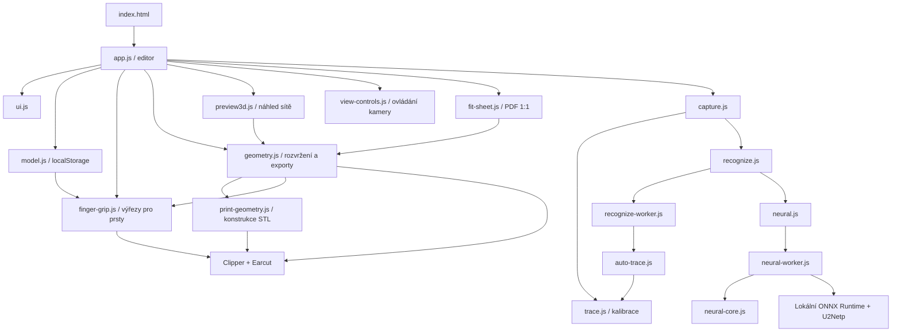

# Architektura Šuplík Studia

Mapa projektu z analýzy 3. 11. 2026. Pracovní strom současně rozvíjí další vlákno; nové výrobní funkce a jejich propojení proto mohou přibývat. Tento dokument popisuje hlavní hranice systému a samostatně označuje rozpracované části.

## Základ aplikace

Šuplík Studio je český editor modulárních organizérů. Běží na zařízení uživatele jako statická webová aplikace v čistém JavaScriptu s ES moduly. Nemá aplikační backend, databázový server, framework ani build krok. Adresář `dist/` obsahuje přímo editované zdrojové soubory i soubory určené k nasazení.

Aktivní projekt je v tomto adresáři. ZIP se zdroji a dva deployment archivy v nadřazeném adresáři jsou samostatné balíčky; nejsou vstupem pro běh nebo testování pracovního stromu.

| Oblast | Soubory | Odpovědnost |
| --- | --- | --- |
| Vstup a vzhled | `dist/index.html`, `dist/style.css`, `dist/fonts/`, `dist/icon.svg` | HTML shell, CSS, lokální fonty a responzivní rozložení |
| Editor | `dist/app.js` | Stav aplikace, SVG pracovní plocha, izometrický náhled, události, historie a koordinace ostatních částí |
| UI pomůcky | `dist/ui.js` | Modal, focus trap, ikony, escapování, oznámení a stahování souborů |
| Datový model | `dist/model.js` | Výchozí projekt, validace/normalizace JSON, ID, kopírování a přístup k localStorage |
| Úchop nástroje | `dist/finger-grip.js` | Automatické boční výřezy, validace jejich parametrů a sjednocená výrobní kontura kapsy |
| Fotografování | `dist/capture.js` | Soubory/kamera, kalibrace, průběh rozpoznávání, kontrola kvality a přidání nástrojů |
| Obrazové algoritmy | `dist/trace.js`, `dist/auto-trace.js` | Papír, perspektiva, komponenty obrazu, kontury a automatický výběr segmentace |
| Rozpoznávání | `dist/recognize.js`, `dist/recognize-worker.js` | Souběh klasické a neuronové analýzy, klasický worker a fallback |
| Neuronová inference | `dist/neural.js`, `dist/neural-worker.js`, `dist/neural-core.js` | Sdílený worker, fronta inference, ONNX session, preprocessing a masky |
| Geometrie a výroba | `dist/geometry.js` | Transformace, rozvržení, validace sestavy, SVG/DXF/ZIP a rozhraní STL |
| Chytré rozvržení | `dist/smart-layout.js`, `dist/smart-layout-client.js`, `dist/smart-layout-worker.js` | Hledání orientací a společných modulů, průběh výpočtu a zrušení mimo hlavní vlákno |
| Sady nástrojů | `dist/tool-sets.js`, `dist/set-layout.js` | Porovnání obrysů, kanonická orientace, ruční členství a sjednocené varianty rozvržení |
| Vložení a měřítko sady | `dist/set-module.js`, `dist/catalog-ui.js`, `dist/catalog/` | Uspořádání sady při vložení, rovnoměrná změna obrysů a katalogové volby |
| Jmenovité velikosti a popisky | `dist/tool-size.js`, `dist/size-labels.js` | Čtení zadaných velikostí, pořadí mm/in, lokální písmo a společný plán skutečného rytí |
| Hromadné úpravy | `dist/bulk-edit.js`, `dist/app.js` | Atomické změny výběru, přesuny celých modulů, kontrola geometrie a jediná transakce historie |
| Úpravy celého modulu | `dist/module-edit.js` | Přesná poloha, čtvrtotáčky všech členů a kopie na volné místo v rastru |
| Konstrukce pro tisk — souběžný vývoj | `dist/print-geometry.js` | Konstrukce sítě, konfigurace tisku, kontrola tiskové plochy, objem a binární STL |
| Náhled sítě | `dist/preview3d.js` | Ortografická 3D kamera, projekce skutečné STL sítě, viditelnost stěn a cache geometrie |
| Ovládání kamery | `dist/view-controls.js` | 2D posun pravým tlačítkem, 3D orbit levým tlačítkem a posun pravým, kolečko pro zoom kolem kurzoru |
| Šablona 1:1 — souběžný vývoj | `dist/fit-sheet.js` | Vektorové PDF A4 s měřítkem a dlaždicovým rozdělením velkého modulu |
| Offline režim | `dist/sw.js`, `dist/manifest.webmanifest` | Service worker, cache a instalovatelná aplikace |
| Spuštění a kontrola | `serve.mjs`, `check.mjs`, `package.json`, `.openai/hosting.json` | Lokální HTTP server, statické kontroly, příkazy a cílový adresář hostingu |

Klasická analýza má také přímou cestu bez workeru pro prostředí, která `Worker` nepodporují.

## Stav, data a ukládání

`app.js` drží aktuální projekt, seznam projektů, knihovnu nástrojů, výběr, pohled a historii v proměnných modulu. Typická editace prochází cestou `commit → remember → persist → render`. UI se převážně překresluje sestavením HTML řetězců; plocha i 3D náhled jsou SVG. Události jsou z velké části delegované. Neexistuje samostatný store ani router.

3D kamera používá samostatný dočasný stav `{yaw, pitch, zoom, panX, panY}`; 2D pohled má vlastní zoom a posun. Kamery se nezapisují do projektu ani jeho historie. Při přepnutí 2D/3D se zachovají; při změně šuplíku nebo obnovení výchozího pohledu se resetují. Cache náhledu drží celé STL trojúhelníky a BSP strom pro správné zakrývání stěn. BSP rozděluje pouze vykreslované polygony, nikoli výrobní geometrii; viditelnost a pořadí vykreslení se odvozují od aktuální kamery. Stabilní prostorový rám a poměr stran plochy oddělují otáčení od zoomu. Ovládání dávkuje překreslení přes `requestAnimationFrame` a zachovává projekční bod pod kurzorem při zoomu. Ve 2D zůstávají levé tlačítko, přesun modulů a úchyty velikosti v obsluze editoru; navigace používá pravé tlačítko a kolečko.

Projekt obsahuje rozměry šuplíku, rastr, vůli, stěnu, dno, výšku a pole `modules` a `tools`. Všechny výrobní délky jsou v milimetrech:

- Modul má ID, absolutní `x/y`, rozměry, zámek polohy a režim velikosti `sizeMode` (`auto` nebo `manual`).
- Nástroj má vlastní ID, lokální polygon `points`, polohu, rotaci ve stupních, hloubku a vazbu `moduleId`.
- Volitelné `tool.fingerGrips` obsahuje nejvýše 12 výřezů `{id, x, y, radius}` v lokálních milimetrech nástroje. Nepřítomné pole označuje původní nástroj bez automatické změny kapsy; explicitní `[]` uchovává smazání. Normalizace souřadnic posouvá centra výřezů stejně jako body nástroje.
- `tool.nominalSize = {value, unit:'mm'|'in'}` uchovává zadanou jmenovitou velikost ve vlastní jednotce. `tool.sizeLabel` je volitelný ruční text do 24 znaků. Obě hodnoty procházejí validátorem a JSON; nejsou rozměrem obálky kontury a škálování je nemění.
- `project.sizeLabels` zapíná výrobní popisky pro celý šuplík, výchozí hodnota je `false`. Vynechaný popisek neblokuje ostatní model; UI uvádí důvod z `SIZE_LABEL_REASONS`.
- `transformedPoints()` otočí lokální polygon, posune jeho obálku k počátku a poté přičte `x/y`. Pozice tak označuje počátek obálky po otočení.
- `validateProject()` kontroluje strukturu a rozsahy, doplní výchozí hodnoty a normalizuje body. Výrobní platnost kontroluje zvlášť `validateLayout()`.
- Limity importu jsou 300 nástrojů, 400 modulů a 3–6000 bodů na konturu. Normalizovaný rozměr kontury smí být nejvýše 3000 mm v každé ose.

Klíče localStorage jsou `suplik-studio-projects-v1`, `suplik-studio-current`, `suplik-studio-library-v1` a nastavení úvodního tipu. JSON export obsahuje obálku `schemaVersion: 1`, identifikaci aplikace a projekt. Import přijímá obálku i přímý projekt. Fotografie se do projektu neukládají. Není zde vzdálená synchronizace ani uživatelský účet.

Jeden projekt v datovém modelu odpovídá jednomu fyzickému šuplíku. UI jej představuje jako pojmenovaný šuplík: vytvoření vyžaduje název a vnitřní rozměry, nabídka **Moje šuplíky** přepíná několik nezávislých sestav a **Rozměry šuplíku** zpřístupňuje editaci i po výběru nástroje. Existující projekty používají stejné identifikátory a klíče úložiště.

Undo/redo ukládá hluboké kopie projektu pouze do paměti. Běžné změny omezují undo na 40 snímků; větev dokončení tažení tento limit zatím nesdílí. Obnova ze storage neplatné projekty vyřazuje, proto je stabilní opakovaná validace dat důležitá.

## Tok fotografie do kontury

1. `capture.js` načte fotografii do Canvas a omezí delší stranu na 1400 px. Soubory mají limit 20 MB. Souběžný vývoj doplňuje nativní dekódování HEIC a ověření rozlišení.
2. Režim A4 najde světlý papír, odhadne orientaci a projektivně jej narovná na 210 × 297 mm, s delší stranou nejvýše 1100 px. Pravítko poskytne měřítko ze dvou bodů a známé vzdálenosti; perspektivu neopravuje.
3. `recognizeTools()` spustí klasickou analýzu a neuronovou segmentaci souběžně. Při úspěchu neuronové části se klasická analýza zopakuje s pravděpodobnostní maskou. Při nedostupné neuronové části zůstává klasická cesta.
4. Klasická analýza odhaduje barvu a osvětlení papíru, hledá hrany a porovnává několik segmentačních kandidátů. `traceMask()` trasuje hotové binární masky bez dalšího rozmazání a morfologického spojování; zachovává úzké mezery. Dotýkající se protáhlé nástroje lze oddělit podél viditelné RGB hranice, pokud výsledek podporují samostatně viditelné dříky a celistvé kontury. Kontrola fragmentů používá orientaci a skutečné vzdálenosti kontur místo překryvu jejich obdélníků. Oříznuté objekty se odmítají.
5. Model U2Netp používá vstup 320 × 320 v CHW RGB. Jeden sdílený neuronový worker drží ONNX session a serializuje inference. Skutečné hrany se zpřesňují obrazovou analýzou ve vyšším rozlišení.
6. Výsledek má kvalitu `ready`, `review` nebo `retake`. Přidání dovoluje pouze `ready`. Body se normalizují k počátku nástroje a vydělí měřítkem px/mm; editor je převezme přes callback `onAdd`.

Reset a zavření dialogu ruší úlohu a kontrola identity běhu brání použití starého výsledku. Klasický worker žije po dobu jednoho výpočtu. Zrušení neuronové úlohy ukončuje sdílený worker a jeho čekající požadavky; timeout je 60 sekund.

Fotografie se nikam neodesílají. Model, runtime i fonty jsou lokální soubory stejného hostingu. Model má přibližně 4,6 MB, WASM 11,2 MB; celá neuronová část přibližně 16 MB. Licence a původ jsou v `dist/models/` a `dist/vendor/`. U2Netp je obecný model popředí, ne záruka rozměrové přesnosti.

## Geometrie, rozvržení a exporty

Geometrická vrstva nemá závislost na DOM. Používá lokální Clipper pro posun a booleovské operace kontur a Earcut pro triangulaci ploch s otvory. Souběžný vývoj vyčleňuje konstrukci STL do `print-geometry.js`; veřejné exportní rozhraní zůstává v `geometry.js`.

`autoArrange()` klonuje projekt, řadí nástroje podle plochy obálky a hledá místa v rastru pro aktuální otočení a otočení o 90°. Zachovává zamčené moduly, moduly se zamčeným nástrojem i prázdné výplně. Neumístěné nástroje zůstávají součástí projektu. Jde o heuristiku, která nezaručuje nejúspornější rozvržení.

`resizeModule()` vrací nový projekt a při neplatné změně původní stav nemění. Ruční rozměry jsou jmenovité milimetry; automatická velikost počítá obálku otočených kontur včetně vůle, přidá stěny a výrobní mezeru a zaokrouhlí nahoru do rastru. Nástroje pouze společně vycentruje, jejich body ani rotaci neškáluje. Ručně nastavené moduly zůstávají při automatickém rozvržení skupinou s pevnými rozměry; režim velikosti sám nezamyká jejich polohu. Neumístěná ruční skupina přežije uložení a může se znovu umístit po rozšíření šuplíku.

Přímou změnu velikosti přes SVG úchyty koordinuje `app.js`: kandidáty počítá z počátečního snímku projektu, omezuje je minimem pro kapsy a stěny, sousedy a šuplíkem a ověřuje přes `resizeModule()`. Jeden dokončený tah vytvoří jediný krok historie; zrušený tah vrátí snímek. Tlačítka −/+ a Alt+Shift+šipky mění rozměr o krok rastru. Ruční změna jednoho modulu sjednocené sady přepne požadavek sady z `uniform` na `auto` s upozorněním.

`scaleTool()` v `set-module.js` mění lokální body a centra výřezů stejným poměrem v rozsahu 0,2–5; hloubka a poloměry výřezů zůstávají skutečnými milimetry. Editor zachovává střed umístěného obrysu a odmítá změnu, která by vyžadovala automatické přemístění výřezů. Automatický modul se znovu přizpůsobí, ruční si rozměry ponechá. Katalog přijímá procenta nebo cílovou délku nejdelšího vybraného obrysu, škáluje kopie a před vložením zobrazuje rozměry.

`addToolGroup()` v `set-module.js` skládá úplné kapsy včetně výřezů do řad podle jejich kontur, porovnává orientace a velikosti v rastru a výslednou skupinu ověřuje přes `validateLayout()`. Vložení katalogové sady může vytvořit jeden společný modul nebo samostatné stejně velké moduly se společným směrem nástrojů a zaznamenává editovatelné členství v `project.toolSets`. Vrací `reason:'ok'|'drawer'`; tisková podložka volbu kandidátů ani výsledek editoru neovlivňuje. Hromadné vložení předává intervaly jednotlivých sad v `collections`, zachovává jejich členství, měřítko a rozložení a přijímá celý výběr jedinou transakcí historie. Při nedostatku místa zůstanou nástroje v projektu a `offerFit()` nabídne konkrétní rozšíření nebo nový šuplík. Nový šuplík zachová společné i sjednocené samostatné moduly a přenese členství příslušných sad.

Volby `arrangement:'ordered'|'compact'` a `order:'asc'|'desc'` platí pro vložení i `splitForBed()`. Explicitní přehledné řady mají společný směr a zarovnané spodní hrany. Úsporná varianta zachovává monotónní úseky pořadí, používá profil úplné kapsy a porovnává otočení o 180°; při stejné ploše v rastru má přednost neotočená varianta. Rozdělení pro tiskovou plochu udržuje souvislé velikostní rozsahy v pevných modulech a vrací zvlášť příliš dlouhé nástroje. Packer předem hlídá limity 300 nástrojů a 400 modulů a parkované moduly mají souřadnice slučitelné s opětovným načtením.

`tool-size.js` čte jmenovitou velikost, případně údaj s explicitním mm/in v názvu; podporuje i palcové zlomky. `sizeText()` upřednostní ruční text. Comparator převádí jmenovité velikosti na mm, délku obrysu používá pouze jako náhradní klíč řazení. Z kontury ani fotografie nevytváří jmenovitou velikost.

Přeuložení existující sady koordinuje `app.js`: odmítne zamčené členy a moduly sdílené s jinou sadou, znovu sestaví pouze zvolenou sadu a zachová ID nástrojů, obrysy, hloubky, popisky i ID sady. Celá změna se přijme jediným `commit()` a lze ji vrátit jedním krokem.

`bulk-edit.js` vrací klon projektu a před přijetím kontroluje dotčenou geometrii, hloubky, zámky a rastr Gridfinity. `bulkMove()` a zámek se rozšíří na celé dotčené moduly včetně nevybraných sourozenců; `bulkMoveTools()` mění pouze vybrané kapsy v pevných modulech. `bulkAlignTools()` a `bulkDistributeTools()` zarovnávají otočené původní obálky v jednom modulu; rozestupy zachovávají krajní nástroje. Skutečné kapsy včetně výřezů a stěn se následně validují. Změna hloubky, mazání a explicitní `bulkFingerGrips()` se týkají vybraných nástrojů. UI drží dočasný `bulkSelection`, propojuje checkboxy, modifikované klepnutí a klávesové zkratky. Tažení výběru počítá náhled od počátečního snímku, při chybě či zrušení jej obnoví a úspěšný tah uloží jako jeden krok historie.

Výběr má jednotný vizuální predikát `isToolSelected()`: neprázdný `bulkSelection` určuje přesné členy, jinak se zobrazuje aktivní jednotlivý nástroj. 2D kapsy a těla, řádky seznamu i tlačítka členů modulu sdílejí `data-tool-selected` a `is-selected`; ovládací prvky také `aria-pressed`. Aktivní nástroj mimo hromadný výběr nepřebírá jeho zvýraznění. Prosté klepnutí na nástroj přepne na jeho jednotlivé vlastnosti a hromadný výběr zruší; pozadí modulu odznačí nástroje a vybere modul bez automatického výběru jeho jediného člena. Přepnutí na další modul ani dokončení výběru po zachycení ukazatele na SVG nemění projekt a nevytváří krok historie.

`.inspector-selection` obsahuje kontextové akce mimo samostatně posouvanou `.inspector-scroll` s pojmenovanou klávesnicově dostupnou oblastí. Základní akce zůstávají viditelné; další jsou v `details.bulk-more`. Hromadný kontext ukazuje `.bulk-selected-list` místo dlouhého formuláře jednoho člena. Pokročilé jednotlivé vlastnosti používají `details.inspector-section[data-inspector-section]`. Při překreslení stejného kontextu se uchovává otevření sekcí a pozice posunu; změna vybraného nástroje začne na základních vlastnostech. CSS omezuje výšku seznamu členů modulu a udržuje náhled a ovládání dostupné v rozměrech viewportu. DOM regrese testují skutečné zvýraznění, synchronizaci výběru, dostupnost akcí a jejich atomický efekt; fyzické rozměry a překrývání vyžadují ověření v prohlížeči.

Otočení se týká pouze vybraných nástrojů kolem jejich vlastních středů. `bulkRotate()` přidá relativní úhel, `bulkSetRotation()` nastaví absolutní úhel. Ve společném modulu ponechají jeho rozměry i ostatní nástroje beze změny a při kolizi nebo přesahu odmítnou celou operaci. Automatický modul s jediným nástrojem se může přizpůsobit novému natočení.

`module-edit.js` odděluje úpravy celého kontejneru od úprav jeho kapes. `moveModule()` mění absolutní X/Y a přeloží všechny členy; `rotateModule()` přijímá násobky 90°, zachová levý horní roh a otočí obálku i středy všech nástrojů. `duplicateModule()` hledá první volné místo v rastru bez přepočítání ostatních modulů. Kopie má samostatné hluboké kopie kontur, nové ID modulu, nástrojů i výřezů a je odemčená. Úplná sada dostane vlastní zkopírované členství; neúplná sada se na kopii nepřenáší. Tyto operace kontrolují dotčenou geometrii a rastr Gridfinity, nesouvisející chyby jinde v projektu neblokují. Rozměry tiskové podložky do nich nevstupují.

`automaticFingerGrips()` volí dva boční kruhy u skutečně vyplněného řezu hlavní osou nástroje. Novým nástrojům je přidává `addTools()`; stávající konfiguraci včetně smazání zachovává. `pocketOutline()` sjednocuje obrys s vůlí a výřezy přes Clipper, zachovává původní kotvu otočeného nástroje a vyžaduje plošné napojení každého výřezu. Poloměr kruhu je skutečná velikost v mm bez dalšího přídavku vůle; hloubka odpovídá kapse nástroje. Obálky modulů, kolize a všechny výrobní výstupy používají tuto rozšířenou konturu. `bounds()` a `transformedPoints()` nadále popisují samotný naměřený nástroj.

`validateLayout()` kontroluje přesahy a překryvy modulů, kontury, přiřazení kapsy, stěny, hloubku, průnik i dotyk kapes. Minimální stěna mezi kapsami stejného modulu se měří mezi konturami po započtení vůle. Společná exportní validace blokuje neplatnou výrobu; samostatný platný modul lze exportovat i při chybách jinde v sestavě.

- SVG používá rozměry v mm a obrysy modulů a kapes.
- DXF používá uzavřené polylinie, metrické jednotky a vrstvy `MODULES/POCKETS`.
- Binární STL skládá horní plochu s otvory, ploché dno, obvodové stěny a dna kapes. Vnější rozměr modulu je o 0,5 mm menší než jmenovitý rozměr v rastru.

- ZIP obsahuje samostatné soubory, CRC32 a UTF-8 názvy; nepoužívá kompresi.
- JSON uchovává editovatelný projekt a lze jej uložit i pro výrobně neplatnou sestavu.

`bedWidth`, `bedHeight` a `limitToBed` se ukládají beze změny i ve starších projektech. Editor, `validateLayout()`, změna velikosti a všechny režimy rozvržení je pro umístění ignorují. `exportSTL()` a `printStats()` mají volbu `checkBed=true`; pouze interní náhledy a ověření výrobní geometrie kandidátů předávají `checkBed:false`. Tím zůstávají zachované kontroly uzavřenosti sítě, stěn, dna a složitosti. SVG/DXF podložku nekontrolují. `splitForBed()` je výslovná exportní operace a dál respektuje uložené rozměry podložky, hlásí `oversize` i `reason:'bed'`; UI ji provádí až na samostatný pokyn v exportu.

`planSizeLabels()` sdílí stejný plán popisků pro 2D, náhled a STL. Lokální písmo 5×7 vytváří tahy široké nejméně 0,5 mm, znak vysoký 3,5 mm a rytí hluboké 0,35 mm. Plný díl má skutečně zapuštěný text; úsporný díl přidává štítek do stejného uzavřeného tělesa nad zachované dno. Plán obchází kapsy včetně výřezů a požadovaných stěn. Chybějící údaj, nepodporovaná diakritika, malá výška nebo nedostatek prostoru mají samostatné důvody vynechání, které překládá a zobrazuje UI.

Souběžné vlákno rozšiřuje tisková nastavení, typy dna, odhady tisku a zkušební výstupy. Jejich rozpracovaná pole `printMode`, `bottomMode`, `bedWidth/bedHeight`, `limitToBed` a parametry magnetů nelze považovat za samostatně dokončenou funkci jen podle přítomnosti v datovém modelu.

`smartArrange()` hledá vhodné orientace obrysů a menší společné moduly. Optimalizace používá úplné kapsy včetně výřezů pro prsty, zachovává zámky a ruční skupiny a před přijetím kontroluje výrobní geometrii. Odpovídající moduly mají volitelné `grouped: true`; normalizace JSON a běžné `autoArrange()` tuto skupinu zachovávají. Výpočet běží přes samostatný worker a klient ruší nebo odmítá zastaralé výsledky. Přijetí je jediná transakce historie. Hlášená úspora porovnává součet vnějších obdélníkových půdorysů modulů (šířka − 0,5 mm) × (hloubka − 0,5 mm); hledání má omezený rozsah a není důkazem globálního optima.

Volitelné `project.toolSets` uchovává ruční sady `{id, name, toolIds, layout}` s režimem `auto`, `uniform` nebo `shared` a volitelnými preferencemi `arrangement` a `order`. Jeden nástroj patří nejvýše do jedné ruční sady. Automatické návrhy vycházejí z normalizovaných geometrických profilů a nejsou vydávány za rozpoznaný výrobek. `analyzeToolShape()` určuje orientaci hlavní osy včetně rozlišení protilehlých konců; `findToolSets()` upřednostňuje ruční členství a `setCoherence()` nezávisle měří splnění zvolené varianty. Pouze explicitní `arrangement:'compact'` připouští protilehlé směry 0/180°; starší sady zachovávají požadavek na jediný směr. Moduly mohou nést `setId` a `setLayout`; běžné Auto zachovává společný půdorys samostatných sjednocených modulů. Při rozvržení sad lze znovu sestavit dřívější odemčené automatické skupiny, zatímco ruční rozměry, zámky a výplně zůstávají chráněné.

## Spuštění a offline režim

`npm run dev` spouští `serve.mjs` na portu 5173, naslouchá na `0.0.0.0` a servíruje `dist/`. Nastavuje MIME typy modulů, WASM a ONNX. V PowerShellu lze použít `npm.cmd run dev`. Produkční hosting potřebuje statické soubory přes HTTP(S); kamera a instalace vyžadují bezpečný kontext, například HTTPS nebo localhost.

Service worker přednačítá editor a při běžném provozu ukládá úspěšné GET odpovědi stejného originu. Používá strategii síť před cache. Model a runtime nejsou v původním seznamu přednačítání: offline neuronové rozpoznávání proto závisí na jejich předchozím úspěšném načtení a uložení. Verze cache se mění ručně. Při aktivaci se odstraňují ostatní cache daného originu, což je důležité při sdíleném hostingu s jinou aplikací.

## Ověřování a hranice dalšího vývoje

`npm test` používá vestavěný Node test runner. Happy DOM simuluje editor, `@napi-rs/canvas` poskytuje skutečný raster a `tests/worker-adapter.mjs` spouští původní browser workery přes Node worker threads. Testy inference načítají skutečný přiložený ONNX model i WASM runtime.

`npm run check` kontroluje syntaxi hlavních skriptů, existenci relativních importů a souborů deklarovaných pro offline cache. Neověřuje shodu jmen importovaných exportů; tu zachytí až načtení modulů v integračních testech.

Pokrytí zahrnuje editor a persistenci, JSON, kalibraci, segmentaci, zrušení úloh, zámky a rozvržení, metrické exporty, CRC/ZIP a uzavřenost, orientaci i objem STL. Nové regresní případy chrání zkratku Ctrl/Meta/Alt+R, stabilitu normalizace kontur, kontakty kapes a minimální vnitřní stěnu.

Výřezy pro prsty mají samostatné testy automatického umístění, normalizace, ukládání, editace a výrobní geometrie. Ověřují i skutečně prázdné místo v dutině, zachované dno a uzavřenost sítě v obou konstrukcích a různých typech dna. Samostatná HTTP kontrola základního serveru ověřila šest cest, MIME typy WASM/ONNX, chybějící soubor a odmítnutí cesty mimo `dist/`. Každé vydání vyžaduje nový běh odpovídajících kontrol aktuálního zdroje.

Zbývající důležité limity:

- Detektor světlého papíru neprokazuje, že jde fyzicky o A4. Správné měřítko závisí na správné předloze a kvalitě fotografie.
- Chybí skutečný mobilní E2E/visual test a reprezentativní fotografická sada. Simulovaný DOM neověřuje nativní dekodér HEIC ani chování kamery.
- Bez workerů může klasická analýza blokovat hlavní vlákno. Validace geometrie navíc porovnává páry polygonů a jejich hran, takže složité importy mohou být výpočetně náročné.
- Migrace dat není samostatná vrstva; kompatibilitu nyní zajišťují výchozí hodnoty a validátor. Nová trvalá pole musí projít validací i JSON roundtrip testem.

Pro paralelní práci se osvědčují tři hranice: editor/data (`app.js`, `ui.js`, `model.js`), fotografie/rozpoznávání (`capture`, `trace`, `auto-trace`, `recognize`, `neural`) a geometrie/exporty (`geometry.js`). Každá větev má přidělené související testy. Sdílené soubory jako `package.json`, service worker a dokumentaci má v jednu chvíli upravovat jediný koordinátor. Před závěrečným testem je nutné spojit změny a zkontrolovat aktuální pracovní strom.
